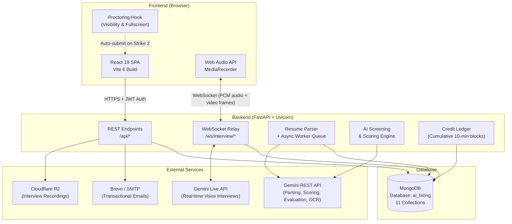
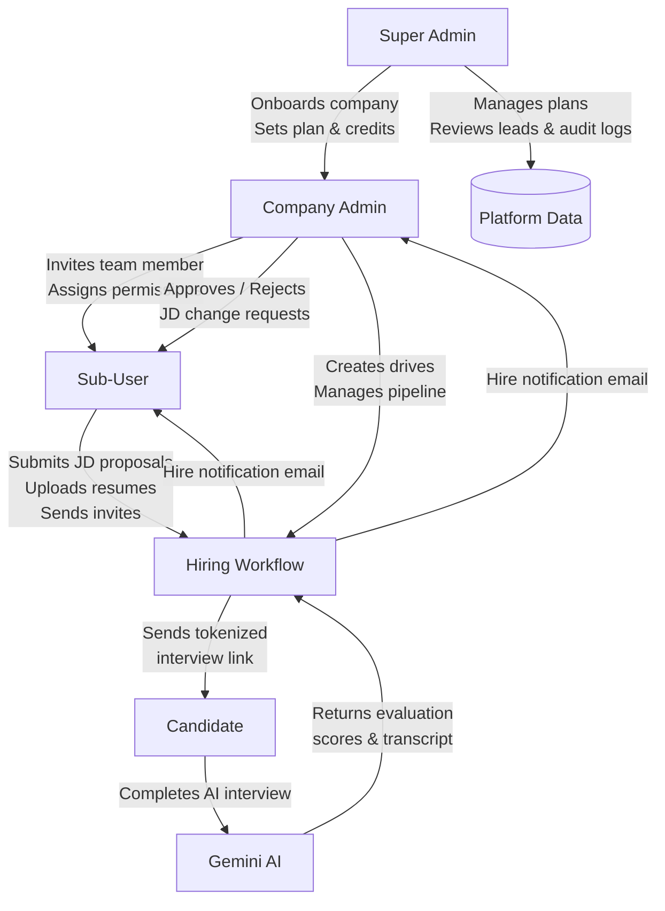
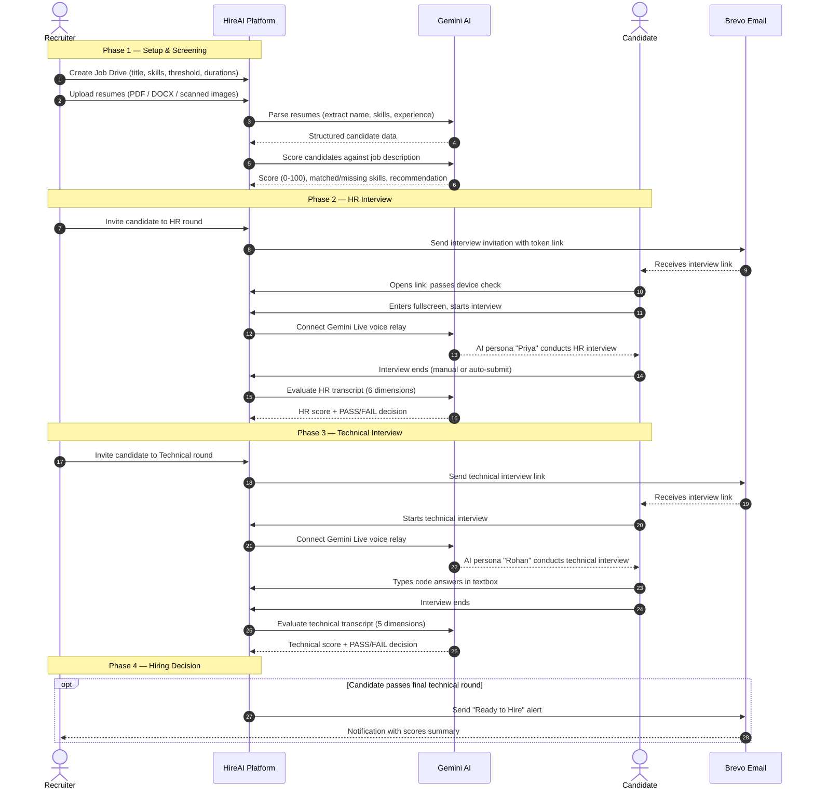

# Silveri Hire (HireAI) — Technical Handover Documentation

> **Version**: 1.0
> **Last Updated**: November 2026
> **Status**: Live
> **Live URL**: `https://interviewai-zjoo.onrender.com`

---

## Table of Contents

1. [Introduction &amp; Project Overview](#1-introduction--project-overview)
2. [Overall System Architecture](#2-overall-system-architecture)
3. [Main Users &amp; Their Responsibilities](#3-main-users--their-responsibilities)
4. [User Permissions &amp; Interactions](#4-user-permissions--interactions)
5. [Complete Hiring Workflow](#5-complete-hiring-workflow)
6. [Feature-wise Explanation](#6-feature-wise-explanation)
7. [Technology Stack](#7-technology-stack)
8. [Backend &amp; Frontend Structure](#8-backend--frontend-structure)
9. [Database Overview](#9-database-overview)
10. [API Overview](#10-api-overview)
11. [Authentication &amp; Authorization](#11-authentication--authorization)
12. [AI Integrations &amp; External Services](#12-ai-integrations--external-services)
13. [Local Installation &amp; Setup](#13-local-installation--setup)
14. [Environment Configuration](#14-environment-configuration)
15. [Deployment Overview](#15-deployment-overview)
16. [Known Issues &amp; Future Improvements](#16-known-issues--future-improvements)

---

## 1. Introduction & Project Overview

**Silveri Hire** is a multi-tenant, AI-powered hiring SaaS platform that automates the full recruitment pipeline — from resume intake and AI-powered screening, through real-time voice interviews conducted by Google Gemini AI personas, to final hiring decisions with automated notifications.

### What the Platform Does

- Companies (Admin or its staff) create **Job Drives** with specific role requirements.
- Recruiters upload candidate resumes which are **automatically parsed and scored** by AI.
- Shortlisted candidates receive tokenized interview links via email.
- Candidates attend **live voice interviews** with an AI interviewer (HR round with persona "Priya", Technical round with persona "Rohan").
- The AI evaluates each candidate against structured rubrics and returns scores, strengths, gaps, and pass/fail decisions.
- When a candidate passes the final round, the entire hiring team is automatically notified.

### Multi-Tenancy

Every piece of data — jobs, candidates, scores, transcripts, recordings — is scoped to a `company_id`. Companies are onboarded by a Super Admin and operate in complete isolation from one another.

---

## 2. Overall System Architecture



### How the Layers Communicate

| Path                           | Protocol                                                 | Purpose                                                       |
| ------------------------------ | -------------------------------------------------------- | ------------------------------------------------------------- |
| Browser → Backend (REST)      | HTTPS with JSON body, JWT `Authorization` header       | All CRUD, file uploads, evaluation triggers                   |
| Browser ↔ Backend (WebSocket) | `wss://` with PCM audio frames + JSON control messages | Live interview audio relay                                    |
| Backend → Gemini REST API     | HTTPS (`urllib.request`) with API key header           | Resume parsing, scoring, evaluation, OCR, question processing |
| Backend ↔ Gemini Live API     | Persistent session via `google-genai` SDK              | Real-time bidirectional voice streaming during interviews     |
| Backend → Brevo / SMTP        | HTTPS API or SMTP                                        | Sending invitation, credential, and notification emails       |
| Backend → Cloudflare R2       | S3-compatible HTTPS (boto3)                              | Uploading and serving interview recordings                    |
| Backend → MongoDB             | TCP (pymongo driver)                                     | All persistent data storage                                   |

---

## 3. Main Users & Their Responsibilities

There are **three authenticated roles** and one **unauthenticated participant type**.

### 3.1 Super Admin (Platform Owner)

- Seeded automatically at application startup from environment variables (`SUPER_ADMIN_EMAIL`, `SUPER_ADMIN_PASSWORD`).
- Only one Super Admin exists per deployment.

**Responsibilities:**

- Onboard new tenant companies (creates the company and its first admin user).
- Manage subscription plans (Starter / Growth / Enterprise) and credit allocations.
- Add or deduct credits for any company.
- Suspend, reactivate, archive, or permanently delete companies.
- Monitor platform-wide statistics (companies, users, candidates, interviews).
- Review all platform audit logs.
- Manage incoming sales leads from the public "Book a Demo" page.

**Dashboard:** `SuperAdminDashboard` — a dedicated panel with platform metrics, company management, plans configuration, audit logs, and lead management.

### 3.2 Company Admin (Organization Owner)

- Created by the Super Admin during company onboarding.
- Receives initial login credentials via email (must reset password on first login).

**Responsibilities:**

- Create and manage Job Drives (job descriptions with requirements, thresholds, interview durations, and custom coding questions).
- Upload candidate resumes and trigger AI screening.
- Review candidate scores, pipeline status, interview transcripts, and recordings.
- Send interview invitation emails to candidates.
- Override pipeline stages (e.g., advance a candidate who failed HR to the Technical round).
- Manage team members (create Sub-users, assign permissions, reset passwords).
- Review and approve or reject JD change requests from Sub-users.
- Monitor credit usage and company activity logs.

**Dashboard:** Main Hiring Workspace (`/app/dashboard`, `/app/job`, `/app/resumes`, `/app/pipeline`, `/app/team`, `/app/usage`).

### 3.3 Sub-User (HR Recruiter / Interviewer)

- Created by Company Admin with selected permissions.
- Receives login credentials via email.

**Responsibilities:** Determined entirely by assigned permissions (see section 4). Can range from full hiring workflow access to view-only pipeline monitoring.

**Dashboard:** Same Hiring Workspace as Company Admin, but tabs and actions are conditionally hidden based on permissions.

### 3.4 Candidate (Public Participant)

- Not a registered user. Accesses the platform only through a unique, single-use tokenized interview URL.
- No authentication required.

**What they do:**

- Complete a camera and microphone pre-check.
- Take a live AI voice interview in fullscreen mode.
- Type written answers to coding questions (Technical round).
- See a "Thank You" confirmation upon completion (scores are not shown to candidates).

---

## 4. User Permissions & Interactions

### 4.1 Sub-User Permission System

Sub-users are assigned a subset of these six granular permissions:

| Permission              | What It Allows                                                                                        |
| ----------------------- | ----------------------------------------------------------------------------------------------------- |
| `manage_jobs`         | Create, edit, or propose changes to Job Drives. Changes by Sub-users go through an approval workflow. |
| `manage_drive_delete` | Delete Job Drives and all associated candidate data permanently.                                      |
| `manage_resumes`      | Upload single or batch resumes for AI parsing and screening.                                          |
| `conduct_interviews`  | Send interview invitations to candidates and reset stuck interview attempts.                          |
| `view_pipeline`       | View the hiring pipeline board, candidate scores, transcripts, and recordings.                        |
| `view_usage`          | View credit consumption history and billing data.                                                     |

> **Note:** Super Admins and Company Admins automatically have all permissions. The permission system only restricts Sub-users.

### 4.2 Role Interaction Diagram



### 4.3 JD Approval Workflow

When a Sub-user with `manage_jobs` permission edits or creates a Job Drive:

1. The Sub-user submits proposed changes.
2. A **JD Change Request** is created with status `pending`.
3. The Company Admin sees the pending request on their dashboard.
4. The Admin can **approve** (changes are applied to the Job Drive) or **reject** (with an optional note).
5. At most one pending request exists per Job Drive at a time — a new submission replaces any existing pending request.

---

## 5. Complete Hiring Workflow



### Pipeline Stages

A candidate progresses through these stages:

```
Uploaded → Screened (Shortlisted / Rejected) → HR Invited → HR Completed (Passed / Failed) → Tech Invited → Tech Completed (Hired / Rejected)
```

At any point, a Company Admin can **override** a failed stage and manually advance the candidate, with a recorded reason.

---

## 6. Feature-wise Explanation

### 6.1 Resume Upload & AI Parsing

**User Journey:** Recruiter selects a Job Drive, drags and drops 1–50 resumes (PDF, DOCX, TXT, PNG, JPG), and sees live upload progress.

**Behind the Scenes:**

1. Files are spooled to a temporary directory and queued in the `resume_jobs` MongoDB collection.
2. Background workers (`backend/services/resume_jobs.py`) claim jobs from the queue and process them concurrently.
3. For readable documents: `pypdf` (PDF) or `python-docx` (DOCX) extracts text.
4. For scanned PDFs or images with no selectable text: Gemini OCR (`backend/services/ocr.py`) extracts text visually.
5. Gemini parses the extracted text into structured JSON: full name, email, phone, skills, experience years, education, links.
6. A regex-based fallback parser runs if Gemini is unavailable.
7. Skills are normalized through 200+ technology aliases (e.g., "JS" → "JavaScript", "React.js" → "React").
8. The parsed candidate is upserted into MongoDB with a compound unique index on `(company_id, job_id, email)`.

**Key Files:**

- `backend/services/resume_parser.py` — parsing logic, skill aliases, Gemini + fallback
- `backend/services/resume_jobs.py` — async queue with workers
- `backend/services/ocr.py` — Gemini-based OCR for scanned documents

**Supported Formats:** `.pdf`, `.docx`, `.txt`, `.png`, `.jpg`, `.jpeg`

---

### 6.2 AI Resume Screening & Ranking

**User Journey:** After parsing completes, each candidate's card shows a match score (0–100), matched/missing skills, and a Shortlisted or Rejected badge.

**Behind the Scenes:**

1. The `AIRankingService` (`backend/services/ai_ranker.py`) sends the parsed resume and job description to Gemini.
2. Gemini scores on 5 weighted dimensions:
   | Dimension                     | Weight |
   | ----------------------------- | ------ |
   | Skills Match                  | 30%    |
   | Experience Alignment          | 25%    |
   | Education Fit                 | 15%    |
   | Job Title Relevance           | 15%    |
   | Project/Description Relevance | 15%    |
3. If Gemini is unavailable, a local fallback scorer uses keyword matching, Jaccard similarity, and experience year comparison.
4. Scores are cached in the candidate document (`cached_score` field) so navigation between pages does not re-trigger scoring.
5. Candidates with scores at or above the drive's configured threshold (default: 80) are marked "Shortlisted"; the rest are "Rejected".

**Key Files:**

- `backend/services/ai_ranker.py` — Gemini-first ranking with local fallback
- `backend/services/ranking.py` — scoring orchestrator with batch caching

---

### 6.3 Live AI Voice Interview

**User Journey:**

1. Candidate receives a branded interview invitation email with a unique link.
2. They open the link and see an instruction page with interview rules and a device pre-check.
3. They grant camera and microphone permissions (both required).
4. They click **Start Interview** → browser enters fullscreen → proctoring activates.
5. The AI interviewer greets the candidate by name and conducts a structured, voice-based interview.
6. For technical rounds, when the AI announces coding questions, a textbox appears for typed answers.
7. The candidate can mute/unmute, and the UI shows real-time status (listening / AI speaking / AI thinking).
8. After the interview ends, a "Thank You" confirmation is displayed. Scores are never shown to the candidate.

**Behind the Scenes:**

1. `liveClient.js` captures microphone audio, downsamples it from the browser's native rate (44.1/48 kHz) to 16 kHz PCM, and streams it over a WebSocket.
2. The FastAPI backend (`backend/main.py` WebSocket endpoint at `/ws/interview/{token}`) relays audio to Gemini Live API via the `GeminiLiveRelay` (`backend/live/relay.py`).
3. Gemini's voice response (24 kHz PCM) streams back through the relay and plays through the browser's Web Audio API.
4. Transcripts are stored turn-by-turn in MongoDB as the conversation happens.
5. Camera heartbeat: Every 5 seconds, a 160×120 JPEG frame is captured from the camera and sent over the WebSocket as a liveness proof.
6. `MediaRecorder` records the full session (camera video + mic audio + AI audio mixed) into a WebM file.
7. Upon interview end, the WebM recording is uploaded to Cloudflare R2 (or local temp storage as fallback).

**Two Interview Types:**

| Feature          | HR Round                                                                | Technical Round                                                                            |
| ---------------- | ----------------------------------------------------------------------- | ------------------------------------------------------------------------------------------ |
| AI Persona       | "Priya" (HR Manager)                                                    | "Rohan" (Senior Engineer)                                                                  |
| Focus            | Communication, confidence, behavioral, cultural fit, professionalism    | Problem solving, technical depth, code quality, debugging                                  |
| Structure        | 5 sections (opening → background → behavioral → cultural → closing) | 6 sections (opening → background → core tech → problem solving → scenarios → closing) |
| Coding Questions | None                                                                    | Custom question bank from uploaded files, with typed answer textbox                        |
| Pass Threshold   | ≥ 70 overall, no red flags                                             | ≥ 65 overall, problem solving ≥ 60                                                       |
| Duration         | Configurable per drive (default: 7 min)                                 | Configurable per drive (default: 5 min)                                                    |

**Key Files:**

- `frontend/src/components/interview/InterviewApp.jsx` — full interview UI
- `frontend/src/components/interview/liveClient.js` — WebSocket + audio + recording client
- `backend/live/relay.py` — Gemini Live API relay wrapper
- `backend/services/Technical/prompts.py` — technical interview system prompt and evaluation rubric
- `backend/services/HR_Round/prompts.py` — HR interview system prompt and evaluation rubric

---

### 6.4 Browser Proctoring

**User Journey:** A warning modal appears on the first violation. A second violation instantly ends and submits the interview.

**How It Works:**

- Monitors three browser events: `visibilitychange` (tab switch), `window.blur` (Alt+Tab / focus loss), `fullscreenchange` (Escape key).
- A **10-second grace period** after the interview starts prevents false triggers from page rendering.
- A **cooldown window** (3 seconds between violations, 2 seconds after dismissal) prevents dual-event double-counting.
- **Strike 1:** Warning modal — interview pauses, candidate must dismiss and re-enter fullscreen.
- **Strike 2:** Interview is immediately auto-submitted via `endInterview()`.

**Key File:** `frontend/src/hooks/useProctoring.js`

---

### 6.5 AI Evaluation

After an interview ends (manually by the candidate, by the AI completing its structure, or by auto-submit from proctoring):

1. A **Media Gate** checks that the interview contained genuine participation:
   - Minimum spoken words from the candidate.
   - Audio stream was active.
   - Video heartbeat frames were received.
2. The full transcript is sent to Gemini with the round-specific evaluation prompt.
3. Gemini returns structured JSON: individual dimension scores, a weighted final score, PASS/FAIL decision, natural language feedback, strengths, gaps, and recommendations.
4. If Gemini is unavailable, a **local fallback** estimates a score based on transcript word count (candidate's responses). This is a crude heuristic and flags itself as "local evaluation."
5. Results are persisted in the candidate's MongoDB document.

**Key Files:**

- `backend/services/Technical/technical_evaluator.py`
- `backend/services/HR_Round/hr_evaluator.py`

---

### 6.6 Custom Coding Questions (Technical Round)

**Setup:** Recruiter uploads a question bank (PDF, DOCX, or TXT) or types questions manually. The `QuestionProcessor` sends the raw text to Gemini, which restructures it into clean, normalized questions with topic, difficulty, and expected answer points.

**During Interview:**

1. The question panel stays hidden until the AI interviewer verbally announces the coding questions (detected by keywords like "hiring team" or "answer box" in the transcript).
2. Questions are presented one at a time with a text input area.
3. When the candidate submits a typed answer, it is sent to the AI via the WebSocket and also appended to the transcript as a `written` message.
4. The AI acknowledges written answers and moves to the next question.

**Key File:** `backend/services/Technical/question_processor.py`

---

### 6.7 Credit System

Each company has a monthly credit allowance based on their plan tier:

| Plan       | Credits | Price   |
| ---------- | ------- | ------- |
| Starter    | 500     | $199/mo |
| Growth     | 2,000   | $499/mo |
| Enterprise | 10,000  | Custom  |

**How Credits Are Consumed:**

- **1 credit = 10 minutes (600 seconds)** of interview time.
- Billing is **cumulative**: leftover seconds carry over to the next interview.
- Example: A 14-minute interview (840 seconds) with 0 remainder → 1 credit consumed, 240 seconds remainder carries to the next interview.
- Credit deductions use **atomic MongoDB aggregation pipelines** with unique `event_id`s to prevent double-charging under concurrent load.

**Key Operations:**

- Super Admin can manually add or deduct credits (the company admin is notified by email).
- Company Admins can view usage history at `/app/usage`.

---

### 6.8 Email Notifications

The platform sends **7 types of automated emails** via Brevo API or SMTP:

| Email Type                    | Trigger                                              | Recipient                |
| ----------------------------- | ---------------------------------------------------- | ------------------------ |
| Interview Invitation          | Recruiter invites candidate to HR or Technical round | Candidate                |
| Company Admin Credentials     | Super Admin onboards a new company                   | New Company Admin        |
| Team Member Credentials       | Company Admin adds a Sub-user                        | New Sub-user             |
| Password Reset Link           | User clicks "Forgot Password"                        | Requesting user          |
| Password Changed Confirmation | Password is changed or reset                         | Affected user            |
| Credits Adjusted              | Super Admin adds/removes credits                     | Company Admin            |
| Candidate Hired               | Candidate passes final technical round               | All company team members |

All emails use HTML templates with XSS-safe escaping (`html.escape`). Email sends are logged in the `email_logs` collection with deduplication to prevent sending the same email twice within 60 seconds.

**Key Files:**

- `backend/services/email_service.py` — multi-provider sender (Brevo API, SMTP)
- `backend/services/email_templates.py` — 7 HTML+plain-text template generators
- `backend/services/pipeline_notifier.py` — automated hire notification with atomic one-time claim

---

### 6.9 Audit Logging

Every significant mutation is recorded in the `audit_log` collection:

```json
{
  "actor_id": "user_object_id",
  "actor_email": "admin@company.com",
  "actor_role": "company_admin",
  "company_id": "company_object_id",
  "action": "candidate.invited",
  "category": "candidate",
  "severity": "info",
  "target_type": "candidate",
  "target_id": "candidate@email.com",
  "target_label": "John Doe",
  "ip_address": "203.0.113.5",
  "user_agent": "Mozilla/5.0 ...",
  "metadata": { "interview_type": "hr" },
  "timestamp": "2026-11-24T10:30:00Z"
}
```

Audit logs are paginated and filterable by category, action, severity, date range, and free-text search.

---

### 6.10 Lead Capture & CRM

**Public Page:** The "Book a Demo" page at `/book-a-demo` collects contact name, company, email, team size, hiring volume, and a message. A **server-side math CAPTCHA** prevents automated submissions.

**Admin Panel:** Super Admin can review leads, update their status (new → contacted → qualified → converted → lost), add timestamped notes, and delete leads.

A **demo confirmation email** is automatically sent to the requester.

---

### 6.11 Marketing Pages

Publicly accessible pages that require no authentication:

| Route            | Page              |
| ---------------- | ----------------- |
| `/`            | Landing Page      |
| `/features`    | Product Features  |
| `/pricing`     | Plan Comparison   |
| `/book-a-demo` | Demo Request Form |
| `/privacy`     | Privacy Policy    |
| `/terms`       | Terms of Service  |

---

## 7. Technology Stack

| Layer                        | Technology                               | Version             |
| ---------------------------- | ---------------------------------------- | ------------------- |
| **Backend Framework**  | FastAPI + Uvicorn                        | Latest              |
| **Language (Backend)** | Python                                   | 3.11+               |
| **Frontend Framework** | React                                    | 19                  |
| **Build Tool**         | Vite                                     | 6                   |
| **Routing**            | react-router-dom                         | 7                   |
| **Icons**              | Lucide React                             | Latest              |
| **Database**           | MongoDB (pymongo)                        | —                  |
| **AI Provider**        | Google Gemini API (REST + Live)          | gemini-2.0-flash    |
| **Email**              | Brevo API / SMTP                         | —                  |
| **Object Storage**     | Cloudflare R2 (S3-compatible, via boto3) | —                  |
| **Auth**               | JWT (HS256) + bcrypt                     | python-jose, bcrypt |
| **PDF Parsing**        | pypdf                                    | —                  |
| **DOCX Parsing**       | python-docx                              | —                  |
| **Deployment**         | Docker (multi-stage) on Render.com       | —                  |

---

## 8. Backend & Frontend Structure

### 8.1 Backend Structure

```
backend/
├── main.py                          # FastAPI application entry point (~2600 lines)
│                                    # All workspace, interview, resume, pipeline routes
│                                    # WebSocket interview relay endpoint
│                                    # Security headers middleware
├── config.py                        # Environment variable loader, frontend_base_url()
├── auth/
│   ├── models.py                    # Pydantic request/response schemas, plan limits
│   ├── routes.py                    # Auth API: login, refresh, logout, password reset
│   └── security.py                  # JWT management, bcrypt, session fingerprinting,
│                                    # rate limiters, permission checker, audit logger
├── admin/
│   └── routes.py                    # Super Admin + Company Admin routes (~1350 lines)
├── core/
│   ├── models.py                    # Dataclasses: JobDescription, ParsedResume,
│   │                                # ResumeScore, CandidateResult
│   ├── sanitizer.py                 # XSS prevention: strip_html, html_escape,
│   │                                # sanitize_for_prompt
│   └── sample_data.py              # Default JobDescription for fallback
├── live/
│   └── relay.py                     # GeminiLiveRelay: wraps google-genai Live API
├── leads/
│   └── routes.py                    # Public lead capture form + admin CRM
├── services/
│   ├── ai_ranker.py                 # Gemini resume scoring with local fallback
│   ├── resume_parser.py             # Resume text extraction + AI structured parsing
│   ├── resume_jobs.py               # Async resume processing queue
│   ├── ranking.py                   # Scoring orchestrator with batch cache
│   ├── drive_metrics.py             # Dashboard funnel metrics computation
│   ├── email_service.py             # Multi-provider email sender (Brevo, SMTP)
│   ├── email_templates.py           # 7 HTML email template generators
│   ├── pipeline_notifier.py         # Automated hire notification
│   ├── ocr.py                       # Gemini-based OCR for scanned documents
│   ├── r2_storage.py                # Cloudflare R2 upload/download + local fallback
│   ├── Technical/
│   │   ├── prompts.py               # Technical interview system prompt + eval rubric
│   │   ├── interviewer.py           # Prompt selector (technical vs HR)
│   │   ├── question_processor.py    # Custom question bank processor
│   │   └── technical_evaluator.py   # Technical transcript evaluator
│   └── HR_Round/
│       ├── prompts.py               # HR interview system prompt + eval rubric
│       └── hr_evaluator.py          # HR transcript evaluator
└── storage/
    └── database.py                  # MongoDB persistence layer (~2200 lines)
                                     # 11 collections, indexes, all CRUD operations
```

### 8.2 Frontend Structure

```
frontend/src/
├── main.jsx                         # App entry: routing, state management, all views
├── constants.js                     # Allowed file extensions
├── styles.css                       # Global stylesheet
├── utils/
│   ├── api.js                       # API client with JWT auth, 401/403 handling
│   ├── csv.js                       # CSV export with formula injection protection
│   └── pipelineStatus.js            # Pipeline status badge derivation
├── hooks/
│   ├── useAuth.js                   # Auth context consumer hook
│   ├── useProctoring.js             # Browser proctoring (2-strike system)
│   └── useUploadProgress.js         # Resume batch upload polling
└── components/
    ├── admin/
    │   ├── SuperAdminDashboard.jsx   # Platform admin panel
    │   ├── CompanyOnboardingModal.jsx
    │   ├── LeadsPanel.jsx           # Lead CRM management
    │   └── ActivityLogViewer.jsx    # Audit log viewer
    ├── auth/
    │   ├── AuthProvider.jsx         # Auth context (login, logout, refresh, permissions)
    │   ├── LoginPage.jsx
    │   ├── ForgotPasswordPage.jsx
    │   └── ResetPasswordPage.jsx
    ├── dashboard/
    │   ├── Dashboard.jsx            # Main workspace dashboard
    │   └── CandidateTable.jsx       # Candidate listing with scores
    ├── job/
    │   ├── JobEditor.jsx            # Job description form
    │   ├── DriveSelector.jsx        # Job drive switching
    │   └── JdApprovalPanel.jsx      # JD change request review
    ├── resumes/
    │   ├── ResumeIntake.jsx         # Resume upload interface
    │   └── UploadProgress.jsx       # Batch progress tracker
    ├── pipeline/
    │   ├── Pipeline.jsx             # Hiring pipeline board
    │   ├── PipelineCandidateRow.jsx  # Individual candidate row
    │   └── OverrideReasonDialog.jsx # Stage override with reason
    ├── candidate/
    │   ├── CandidatePanel.jsx       # Candidate detail panel
    │   └── CandidateResumePreview.jsx
    ├── interview/
    │   ├── InterviewApp.jsx         # Live interview UI (~815 lines)
    │   ├── liveClient.js            # WebSocket + audio + recording client
    │   └── ProctoringWarningModal.jsx
    ├── team/
    │   ├── TeamManagementView.jsx   # Sub-user CRUD
    │   └── CompanyActivityLog.jsx   # Company-scoped audit log
    ├── usage/
    │   └── UsageView.jsx            # Credit usage dashboard
    ├── layout/
    │   ├── Sidebar.jsx              # App navigation sidebar
    │   └── Topbar.jsx               # Top bar with user info
    ├── marketing/
    │   ├── LandingPage.jsx
    │   ├── FeaturesPage.jsx
    │   ├── PricingPage.jsx
    │   ├── BookDemoPage.jsx
    │   ├── PrivacyPolicyPage.jsx
    │   ├── TermsPage.jsx
    │   ├── MarketingLayout.jsx
    │   ├── MarketingNav.jsx
    │   ├── MarketingFooter.jsx
    │   └── marketing.css
    └── common/
        ├── CopyButton.jsx
        ├── Field.jsx
        ├── LoadingScreen.jsx
        ├── Metric.jsx
        └── StatusBadge.jsx
```

---

## 9. Database Overview

**Database:** `ai_hiring` (MongoDB)

### 9.1 Collections

| Collection             | Purpose                                                          | Key Index                                       |
| ---------------------- | ---------------------------------------------------------------- | ----------------------------------------------- |
| `companies`          | Tenant company records (name, plan, credits, status)             | `_id` (ObjectId)                              |
| `users`              | All user accounts (Super Admin, Company Admin, Sub-users)        | `email` (unique)                              |
| `job`                | Job descriptions per company, multi-drive support                | `(company_id, job_id)`                        |
| `candidates`         | Candidate profiles, scores, invitations, interviews, transcripts | `(company_id, job_id, email)` compound unique |
| `audit_log`          | Full audit trail of all mutations                                | `(company_id, timestamp)`                     |
| `usage_log`          | Credit usage tracking                                            | `(company_id)`                                |
| `interview_usage`    | Per-interview credit accounting with idempotent event IDs        | `(event_id)` unique                           |
| `plans_config`       | Subscription plan tier configurations                            | `(plan_name)`                                 |
| `leads`              | Public demo request submissions                                  | `_id`                                         |
| `email_logs`         | Email send history with status                                   | `(to_email, email_type, sent_at)`             |
| `jd_change_requests` | JD approval workflow records                                     | `(company_id, job_id)`                        |
| `resume_jobs`        | Async resume processing queue                                    | `(batchId, status)`                           |

### 9.2 Key Data Relationships

```
Company (1) ──── (*) Users (admin + sub-users)
Company (1) ──── (*) Job Drives
Job Drive (1) ── (*) Candidates
Candidate (1) ── (1) HR Interview (embedded)
Candidate (1) ── (1) Technical Interview (embedded)
Candidate (1) ── (*) Transcript Turns (embedded array)
Candidate (1) ── (*) Override History (embedded array)
```

> **Design note:** Interviews, transcripts, and recordings are **embedded** within the candidate document rather than stored in separate collections. This simplifies queries but means candidate documents can grow large for completed interviews.

---

## 10. API Overview

### 10.1 Public Endpoints (No Auth Required)

| Method        | Route                               | Purpose                                             |
| ------------- | ----------------------------------- | --------------------------------------------------- |
| `GET`       | `/api/health`                     | Health check                                        |
| `POST`      | `/api/auth/login`                 | User login → returns JWT tokens                    |
| `POST`      | `/api/auth/refresh`               | Rotate refresh token → new access + refresh tokens |
| `POST`      | `/api/auth/forgot-password`       | Request password reset email                        |
| `POST`      | `/api/auth/reset-password`        | Submit new password with reset token                |
| `GET`       | `/api/interview/session/{token}`  | Fetch interview session data for a candidate        |
| `POST`      | `/api/interview/evaluate`         | Trigger AI evaluation of a completed interview      |
| `POST`      | `/api/interview/recording/upload` | Upload interview recording (WebM)                   |
| `WebSocket` | `/ws/interview/{token}`           | Live interview audio relay                          |
| `POST`      | `/api/public/leads`               | Submit demo request                                 |
| `GET`       | `/api/public/plans`               | Fetch public plan information                       |
| `GET`       | `/api/public/captcha`             | Get math CAPTCHA for lead form                      |

### 10.2 Authenticated Endpoints — Workspace

| Method     | Route                                       | Purpose                                                        |
| ---------- | ------------------------------------------- | -------------------------------------------------------------- |
| `GET`    | `/api/workspace`                          | Load full workspace data (drives, candidates, scores, metrics) |
| `POST`   | `/api/job`                                | Create or update a Job Drive                                   |
| `GET`    | `/api/job/drives`                         | List all drives for the company                                |
| `POST`   | `/api/job/{job_id}/deadline`              | Set interview deadline                                         |
| `POST`   | `/api/job/{job_id}/questions`             | Upload/process custom question bank                            |
| `DELETE` | `/api/job/{job_id}`                       | Delete a Job Drive and its data                                |
| `POST`   | `/api/resumes/upload`                     | Upload resumes (multipart)                                     |
| `POST`   | `/api/resumes/manual`                     | Add a candidate manually                                       |
| `GET`    | `/api/resumes/upload/{batch_id}`          | Poll batch processing status                                   |
| `POST`   | `/api/candidates/{email}/invite`          | Send interview invitation                                      |
| `POST`   | `/api/candidates/{email}/reset-interview` | Reset a stuck interview attempt                                |

### 10.3 Authenticated Endpoints — Admin

| Method             | Route                                 | Purpose                           |
| ------------------ | ------------------------------------- | --------------------------------- |
| `GET`            | `/api/admin/stats`                  | Platform-wide statistics          |
| `GET/POST`       | `/api/admin/companies`              | List / create companies           |
| `PUT/DELETE`     | `/api/admin/companies/{id}`         | Update / delete a company         |
| `POST`           | `/api/admin/companies/{id}/credits` | Adjust company credits            |
| `GET`            | `/api/admin/audit-log`              | Query platform audit logs         |
| `GET/POST`       | `/api/admin/plans`                  | List / update plan configurations |
| `GET/PUT/DELETE` | `/api/admin/leads/{id}`             | Manage sales leads                |

### 10.4 Authenticated Endpoints — Company Admin

| Method         | Route                      | Purpose                      |
| -------------- | -------------------------- | ---------------------------- |
| `GET/POST`   | `/api/company/team`      | List / create team members   |
| `PUT/DELETE` | `/api/company/team/{id}` | Update / remove team members |
| `GET`        | `/api/company/usage`     | Credit usage history         |
| `GET`        | `/api/company/audit-log` | Company-scoped audit logs    |

---

## 11. Authentication & Authorization

### 11.1 JWT Token Flow

```
Login (email + password)
  → Server verifies bcrypt hash
  → Generates access_token (short-lived) + refresh_token (long-lived)
  → Session fingerprint: access token is bound to the hash of the refresh token
  → Single active session: a new login invalidates the previous session's tokens

Access Token expires
  → Client sends refresh_token to /api/auth/refresh
  → Server rotates both tokens (old refresh token is invalidated)
  → Returns new access_token + refresh_token

Logout
  → Server clears the user's stored refresh token hash
  → Client removes tokens from localStorage
```

### 11.2 Session Security Features

- **Session Fingerprinting:** Each access token contains a `session_fp` claim that must match the SHA-256 hash of the current refresh token. If a leaked access token is used with a different refresh token, it is rejected.
- **Single Active Session:** When a user logs in, their previous `refresh_token_hash` is overwritten. Any outstanding sessions using the old refresh token become invalid.
- **Refresh Token Rotation:** Every refresh produces a new pair of tokens. The old refresh token cannot be reused.
- **Rate Limiting (In-Memory):** Login attempts: 5 per 60 seconds per IP. Forgot-password requests: 3 per 300 seconds per IP.

### 11.3 Permission Enforcement

- Backend checks permissions on every protected route via `require_permission(user, permission)`.
- Super Admin and Company Admin bypass all permission checks.
- Sub-users are checked against their `permissions` array.
- Frontend uses `hasPermission(perm)` to conditionally render UI elements.
- When a Sub-user's permissions are changed by their admin, the frontend receives a `403` with a custom header, dispatches a `auth:permissions-changed` event, and refreshes the user profile.

---

## 12. AI Integrations & External Services

### 12.1 Google Gemini REST API

Used for all non-realtime AI tasks. Called via raw `urllib.request` (no SDK).

| Task                 | Model                | Temp | Input                             | Output                               |
| -------------------- | -------------------- | ---- | --------------------------------- | ------------------------------------ |
| Resume Parsing       | `gemini-2.0-flash` | 0.1  | Raw resume text (up to 15K chars) | Structured JSON (name, skills, etc.) |
| Resume Scoring       | `gemini-2.0-flash` | 0.15 | Parsed resume + job description   | Score breakdown, recommendations     |
| HR Evaluation        | `gemini-2.0-flash` | 0.15 | Resume + transcript               | 6 dimension scores, PASS/FAIL        |
| Technical Evaluation | `gemini-2.0-flash` | 0.15 | Resume + transcript               | 5 dimension scores, PASS/FAIL        |
| Question Processing  | `gemini-2.0-flash` | 0.15 | Raw question bank text            | Structured question array            |
| OCR                  | `gemini-2.0-flash` | 0.1  | Scanned PDF/image                 | Extracted text                       |

**Fallback Behavior:** Every Gemini-dependent service has a local fallback:

- Resume parsing → regex-based extraction
- Resume scoring → keyword matching + Jaccard similarity
- Evaluation → word-count-based heuristic
- Question processing → line splitting

### 12.2 Google Gemini Live API

Used for real-time voice interviews. Called via the `google-genai` Python SDK.

- **Connection:** Persistent session with system instruction (the interviewer prompt).
- **Audio format:** Input: 16 kHz PCM (from browser), Output: 24 kHz PCM (from Gemini).
- **Transcription:** Gemini provides real-time transcription of both interviewer and candidate speech.
- **API key:** Stored server-side only; never exposed to the browser.

### 12.3 Brevo (Email)

- **Primary:** Brevo HTTP API (`api.brevo.com/v3/smtp/email`).
- **Fallback:** Direct SMTP.
- **Configuration:** Set via `EMAIL_PROVIDER` env var (`brevo` or `smtp`).

### 12.4 Cloudflare R2 (Storage)

- S3-compatible object storage for interview recordings.
- Recordings are uploaded with `boto3` using configured R2 credentials.
- Playback uses presigned URLs (default: 1 hour expiry).
- **Fallback:** If R2 is not configured, recordings are saved to a local `temp_files/` directory.

---

## 13. Local Installation & Setup

### Prerequisites

- Python 3.11+
- Node.js 18+ and npm
- MongoDB (local instance or Atlas connection string)
- Google Gemini API key

### Steps

```bash
# 1. Clone the repository
git clone <repository-url>
cd AI_Hiring

# 2. Create and configure environment
cp .env.example .env
# Edit .env with your credentials (see Section 14)

# 3. Install backend dependencies
pip install -r requirements.txt

# 4. Install frontend dependencies
cd frontend
npm install
cd ..

# 5. Build the frontend
cd frontend
npm run build
cd ..

# 6. Start the application
uvicorn backend.main:app --host 0.0.0.0 --port 8000

# The app is now running at http://localhost:8000
# Frontend is served as static files from the backend
```

### Development Mode (Hot Reload)

```bash
# Terminal 1: Backend
uvicorn backend.main:app --host 0.0.0.0 --port 8000 --reload

# Terminal 2: Frontend dev server
cd frontend
npm run dev
# Set VITE_API_BASE=http://localhost:8000 in frontend/.env
```

---

## 14. Environment Configuration

Create a `.env` file in the project root. See `.env.example` for the full template.

### Required Variables

| Variable                 | Purpose                                            |
| ------------------------ | -------------------------------------------------- |
| `GEMINI_API_KEY`       | Google Gemini API key (used for all AI operations) |
| `MONGODB_URI`          | MongoDB connection string                          |
| `JWT_SECRET`           | Secret key for signing JWT tokens                  |
| `SUPER_ADMIN_EMAIL`    | Email for the platform super admin                 |
| `SUPER_ADMIN_PASSWORD` | Initial password for the super admin               |
| `SUPER_ADMIN_NAME`     | Display name for the super admin                   |
| `FRONTEND_URL`         | Public URL of the frontend (used in email links)   |

### Optional Variables

| Variable                                                                                 | Purpose                                 | Default              |
| ---------------------------------------------------------------------------------------- | --------------------------------------- | -------------------- |
| `GEMINI_MODEL`                                                                         | Gemini model name                       | `gemini-2.0-flash` |
| `EMAIL_PROVIDER`                                                                       | `brevo` or `smtp`                   | `smtp`             |
| `BREVO_API_KEY`                                                                        | Brevo API key (if using Brevo)          | —                   |
| `SMTP_HOST` / `SMTP_PORT` / `SMTP_USER` / `SMTP_PASS`                            | SMTP server credentials                 | —                   |
| `FROM_EMAIL` / `FROM_NAME`                                                           | Sender identity for emails              | —                   |
| `R2_ACCOUNT_ID` / `R2_ACCESS_KEY_ID` / `R2_SECRET_ACCESS_KEY` / `R2_BUCKET_NAME` | Cloudflare R2 credentials               | Local fallback       |
| `OCR_ENABLED`                                                                          | Enable Gemini OCR for scanned documents | `true`             |
| `OCR_AUTO`                                                                             | Automatically OCR if no text detected   | `true`             |

---

## 15. Deployment Overview

### Docker Deployment

The project uses a **multi-stage Dockerfile**:

1. **Stage 1 (Node):** Builds the React frontend (`npm run build`).
2. **Stage 2 (Python):** Installs backend dependencies, copies the built frontend into `frontend/dist/`, and runs `uvicorn`.

```bash
# Build and run
docker build -t hireai .
docker run -p 8000:8000 --env-file .env hireai
```

### Render.com (Current Production)

Configured via `render.yaml`:

- **Service Type:** Web Service
- **Build Command:** Handled by Dockerfile
- **Port:** 8000
- **Environment:** Variables set in Render dashboard

### Key Deployment Notes

- The backend serves the frontend as static files from `frontend/dist/`.
- WebSocket connections require the hosting platform to support long-lived WebSocket connections.
- The application runs as a **single process** — the async resume queue runs in-process via Python threads.
- MongoDB must be accessible from the deployment environment (typically MongoDB Atlas for cloud deployments).

---

## 16. Known Issues & Future Improvements

### Known Limitations

| Issue                                                   | Description                                                                                                 | Impact                                                                                                                 |
| ------------------------------------------------------- | ----------------------------------------------------------------------------------------------------------- | ---------------------------------------------------------------------------------------------------------------------- |
| **Monolithic `main.py`**                        | All workspace, interview, and pipeline routes are in a single ~2600-line file.                              | Maintainability; consider splitting into FastAPI routers.                                                              |
| **In-memory rate limiting**                       | Login and forgot-password rate limiters use Python dicts, which reset on server restart.                    | Rate limits don't persist across deploys or restarts. Consider Redis-backed limiting.                                  |
| **No hard interview timeout**                     | The AI is prompted to wrap up at 85% of the target duration, but there is no server-side forced disconnect. | Interviews can technically overrun, consuming additional credits.                                                      |
| **Local evaluation fallback**                     | When Gemini is unavailable, evaluation falls back to a word-count heuristic.                                | Scores from local fallback are unreliable and should be flagged to recruiters.                                         |
| **Large candidate documents**                     | Transcripts, recordings metadata, and interview data are embedded in candidate documents.                   | Documents can grow large for completed interviews; consider extracting transcripts to a separate collection for scale. |
| **Credential emails contain plaintext passwords** | Initial admin and sub-user passwords are sent via email (documented as a known concern in the codebase).    | Should be migrated to a one-time setup token/link flow.                                                                |

### Partially Implemented Features

| Feature                             | Status                 | Notes                                                                     |
| ----------------------------------- | ---------------------- | ------------------------------------------------------------------------- |
| **Cloudflare R2 storage**     | ⚠️ Optional          | Falls back to local `temp_files/` if R2 credentials are not configured. |
| **OCR for scanned documents** | ⚠️ Depends on Gemini | No standalone OCR fallback if Gemini API is unavailable.                  |

### Recommended Future Improvements

| Improvement                              | Description                                                                                             |
| ---------------------------------------- | ------------------------------------------------------------------------------------------------------- |
| **Payment integration**            | Integrate Stripe or Razorpay for automated plan billing and credit purchases.                           |
| **Split `main.py` into routers** | Move workspace, interview, resume, and pipeline routes into separate FastAPI router modules.            |
| **Redis-backed rate limiting**     | Replace in-memory dicts with Redis for persistent rate limiting across restarts and horizontal scaling. |
| **Server-side interview timeout**  | Add a hard disconnect timer on the WebSocket relay to enforce maximum interview duration.               |
| **Setup token for credentials**    | Replace plaintext password emails with one-time setup links where users choose their own password.      |
| **Automated rejection emails**     | Send candidate rejection notifications automatically at each pipeline stage.                            |
| **Test coverage expansion**        | The project has 16 test files covering key areas. Expand to cover all API routes and edge cases.        |

---

> **End of Handover Documentation**
> For quick start and setup, see [README.md](../README.md).
